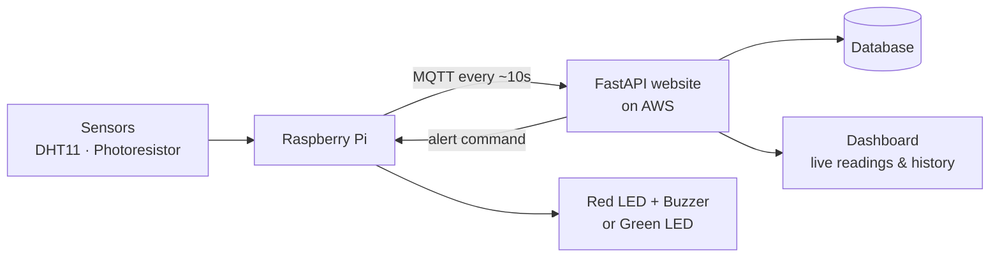

# Plant-monitor
# Plant Monitor

A smart plant monitor. A Raspberry Pi measures the **temperature**, **humidity** and **light** around a plant and sends the readings over the internet to a website. The website shows the readings live and warns me when the plant needs attention.

## The Idea

Plants need the right amount of light and the right temperature to stay healthy. The monitor checks these **every ten seconds**:

- If the plant is too hot, too dry or too dark, a red light and a buzzer warn me, and the website shows an alert.
- If everything is fine, a green light stays on.

## Hardware

| Part | Purpose |
|------|---------|
| Raspberry Pi | The small computer that runs everything (not included in the kit, bought separately). |
| DHT11 sensor | Measures the temperature and humidity of the air. |
| Photoresistor | Measures how much light the plant is getting. Its reading goes through the ADC module. |
| ADC module | Turns the light reading into a number the Raspberry Pi can understand. |
| Thermistor | Optional third reading, such as a second temperature value. |
| Green LED | Lights up when the plant is happy. |
| Red LED | Lights up when the plant needs attention. |
| 2 × 220 Ω resistors | Protect the LEDs from too much current. |
| Active buzzer | Optional sound alert when something is wrong. |
| Breadboard and jump wires | Connect all the parts together without soldering. |
| GPIO cable and extension board | Connect the Raspberry Pi to the breadboard. |

## How It Works

1. The sensors measure the temperature, humidity and light.
2. The Raspberry Pi reads the values and puts them into one small message.
3. The Pi sends this message to the website using **MQTT**, about every ten seconds.
4. The website receives the message and saves it in a database.
5. The website checks the numbers against limits, such as too hot or too dark.
6. If a limit is passed, the website shows an alert and sends a command back to the Pi.
7. The Pi turns on the red light and the buzzer. If everything is fine, the green light stays on.
8. I can log in to the website and see live readings and a chart of the history.

## The Website

The website is built with **FastAPI** and runs on an **AWS** cloud server with its own domain name.

- Users must register and log in before they can see anything.
- The dashboard shows the latest readings, a chart of temperature, humidity and light over time, and a list of past alerts.
- A button on the dashboard lets me test the buzzer or the lights remotely.

## Tech Stack

- **Device:** Raspberry Pi, DHT11, photoresistor + ADC, LEDs, buzzer
- **Messaging:** 
- **Backend:** FastAPI + database
- **Hosting:** AWS with a custom domain

## Roadmap

1. Get the DHT11 and the photoresistor working on the Raspberry Pi
2. Add the LEDs and the buzzer
3. Send messages with MQTT and build the FastAPI website with a database
4. Add the login system and security, and move everything to AWS
5. Record the screencast, finish the README, and complete the AI log and cover sheets
